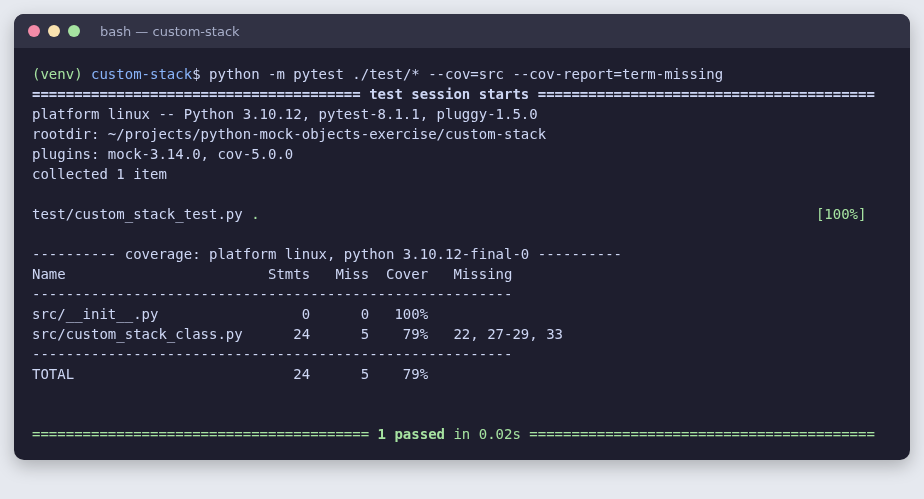
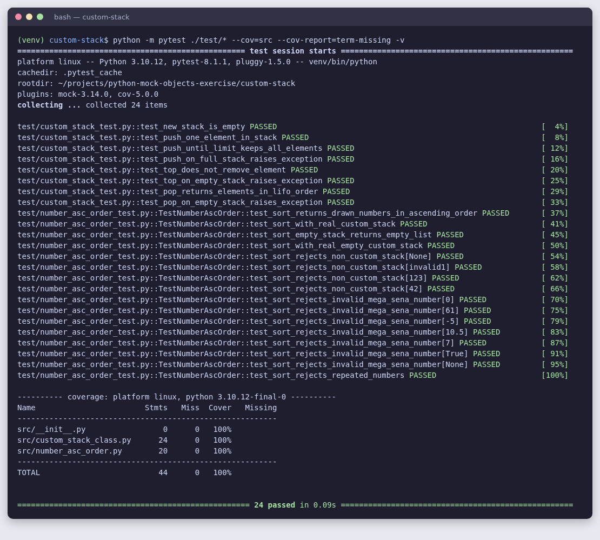
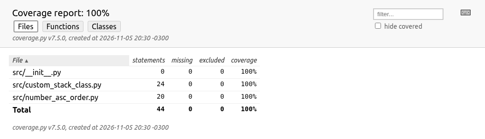

# Exercício Prático – Mock Object (custom-stack)

Projeto em Python com a classe `CustomStack` (uma pilha com limite de tamanho) e a classe `NumberAscOrder`, que ordena os números sorteados da Mega-Sena guardados numa pilha. Os testes usam **pytest**, **pytest-mock** e **pytest-cov**.

| Parte | Objetivo | Resultado |
|---|---|---|
| 1 | Testes de unidade da `CustomStack` com 100% de cobertura | 8 testes, cobertura de 79% → **100%** |
| 2 | Classe `NumberAscOrder` com o método `sort()` e testes usando mock | 16 testes, **100%** de cobertura |

## Estrutura do projeto

```text
custom-stack/
├── src/
│   ├── custom_stack_class.py     # CustomStack, StackEmptyException, StackFullException
│   └── number_asc_order.py       # NumberAscOrder (Parte 2)
├── test/
│   ├── custom_stack_test.py      # testes da CustomStack (Parte 1)
│   └── number_asc_order_test.py  # classe TestNumberAscOrder (Parte 2)
├── docs/screenshots/             # imagens usadas neste README
└── requirements.txt
```

## Preparo do ambiente

Crie uma venv na raiz do projeto e instale as dependências do `requirements.txt` (mais detalhes no [guia oficial do pip](https://packaging.python.org/en/latest/guides/installing-using-pip-and-virtual-environments/)):

```sh
python3 -m venv venv
source venv/bin/activate        # no Windows: venv\Scripts\activate
pip install -r requirements.txt
```

## Execução dos testes

Para rodar todos os testes com o relatório de cobertura no terminal:

```sh
python -m pytest ./test/* --cov=src --cov-report=term-missing
```

Para listar cada teste, adicione `-v`. Para gerar o relatório de cobertura em HTML, que fica em `htmlcov/index.html`:

```sh
python -m pytest ./test/* --cov=src --cov-report=html
```

## Parte 1 – Testes da CustomStack

### Situação inicial: 79% de cobertura

O projeto original tinha um único teste, que fazia um `push` e verificava `is_empty()`, `top()` e `size()`. As linhas do `pop()`, das exceções e da verificação de pilha cheia nunca eram executadas:



### Bug encontrado no `push()`

Ao analisar a efetividade do teste, apareceu um bug que impedia chegar a 100%:

```python
# antes
if (self.size == self.limit):   # compara o método size com um número: é sempre False
    raise StackFullException

# depois
if self.size() >= self.limit:
    raise StackFullException
```

Como `self.size` (sem parênteses) é o próprio método, a comparação nunca era verdadeira. A pilha aceitava elementos além do limite e o `StackFullException` nunca era lançado, então a linha 22 nunca podia ser coberta. O teste `test_push_on_full_stack_raises_exception` foi escrito primeiro, falhou por causa do bug e passou depois da correção. A correção muda só essa linha, sem criar nenhum método novo na classe.

### Casos de teste ([test/custom_stack_test.py](test/custom_stack_test.py))

| Teste | O que verifica |
|---|---|
| `test_new_stack_is_empty` | uma pilha nova está vazia e tem tamanho 0 |
| `test_push_one_element_in_stack` | depois de um `push`, a pilha não está vazia, `top()` devolve o elemento e o tamanho é 1 |
| `test_push_until_limit_keeps_all_elements` | é possível empilhar até o limite |
| `test_push_on_full_stack_raises_exception` | um `push` na pilha cheia lança `StackFullException` e não altera a pilha |
| `test_top_does_not_remove_element` | `top()` consulta o topo sem removê-lo |
| `test_top_on_empty_stack_raises_exception` | `top()` na pilha vazia lança `StackEmptyException` |
| `test_pop_returns_elements_in_lifo_order` | `pop()` devolve os elementos em ordem LIFO |
| `test_pop_on_empty_stack_raises_exception` | `pop()` na pilha vazia lança `StackEmptyException` |

## Parte 2 – NumberAscOrder

### A classe ([src/number_asc_order.py](src/number_asc_order.py))

O método `sort(stack)` recebe uma `CustomStack` com os números na ordem do sorteio, retira cada número com `pop()` até a pilha ficar vazia e devolve uma `list` em ordem crescente. Ele usa só os métodos públicos que a `CustomStack` já tinha.

```python
from src.custom_stack_class import CustomStack
from src.number_asc_order import NumberAscOrder

stack = CustomStack(6)
for number in [42, 7, 59, 13, 1, 30]:   # ordem do sorteio
    stack.push(number)

NumberAscOrder().sort(stack)   # [1, 7, 13, 30, 42, 59]
```

Tratamentos e verificações:

| Situação | Comportamento |
|---|---|
| O argumento não é uma `CustomStack` (`None`, `list`, `str`…) | lança `TypeError` |
| Um número não é inteiro (`10.5`, `"7"`, `True`, `None`) | lança `ValueError` |
| Um número está fora do intervalo 1–60 | lança `ValueError` |
| Um número aparece repetido | lança `ValueError` |
| A pilha está vazia | devolve `[]` |

> **Atenção:** o `sort()` consome a pilha. Depois da chamada, a `CustomStack` recebida fica vazia.

### Testes com mock ([test/number_asc_order_test.py](test/number_asc_order_test.py))

Os testes ficam na classe `TestNumberAscOrder`. Para testar a `NumberAscOrder` isolada da `CustomStack`, a pilha é substituída por um mock do **pytest-mock**:

```python
stack = mocker.Mock(spec=CustomStack)
stack.is_empty.side_effect = [False] * len(drawn_numbers) + [True]
stack.pop.side_effect = list(reversed(drawn_numbers))   # o último sorteado sai primeiro
```

Com `spec=CustomStack`, o mock passa no `isinstance` e só aceita métodos que existem na classe real. Os testes também verificam como a pilha foi usada, por exemplo quantas vezes o `pop()` foi chamado.

| Cenário | Testes |
|---|---|
| **Pilha de 6 posições com os 6 números sorteados (aleatoriamente)** | `test_sort_returns_drawn_numbers_in_ascending_order` (mock: confere a lista ordenada e que o `pop()` foi chamado 6 vezes) e `test_sort_with_real_custom_stack` (com uma `CustomStack` real). Os números são gerados com `random.sample(range(1, 61), 6)`. |
| **Pilha de 6 posições, vazia** | `test_sort_empty_stack_returns_empty_list` (mock: confere o `[]` e que o `pop()` nunca foi chamado) e `test_sort_with_real_empty_custom_stack` |
| Verificações de entrada | `test_sort_rejects_non_custom_stack`, `test_sort_rejects_invalid_mega_sena_number` e `test_sort_rejects_repeated_numbers` (parametrizados) |

## Resultado final

Os 24 testes passam e a cobertura é de 100%:



Relatório de cobertura em HTML (`--cov-report=html`):


